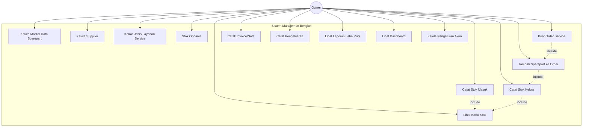
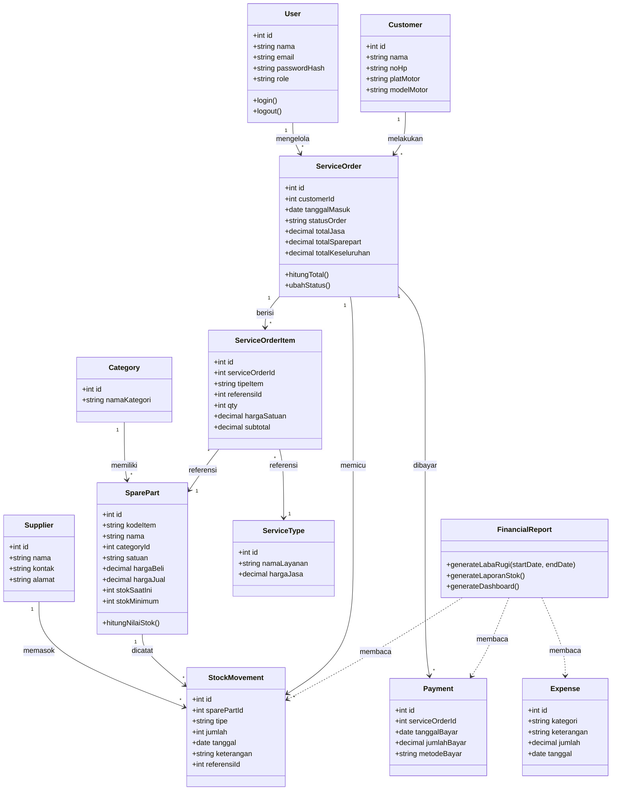
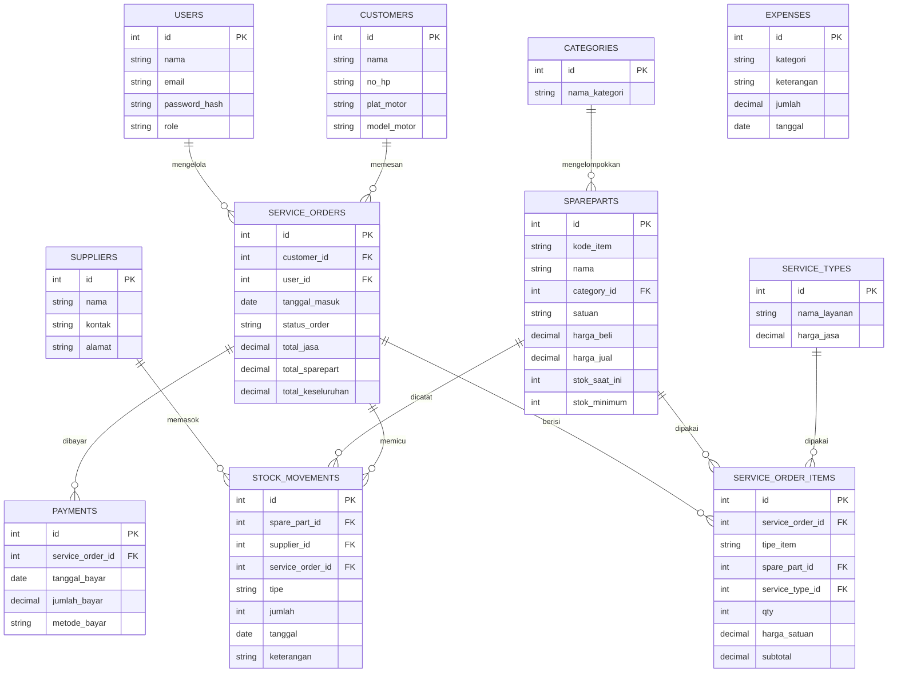
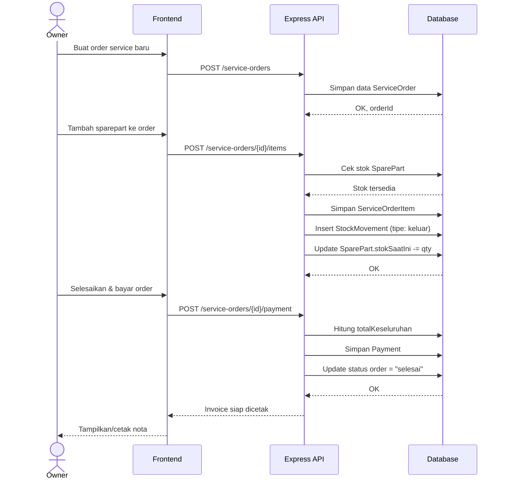
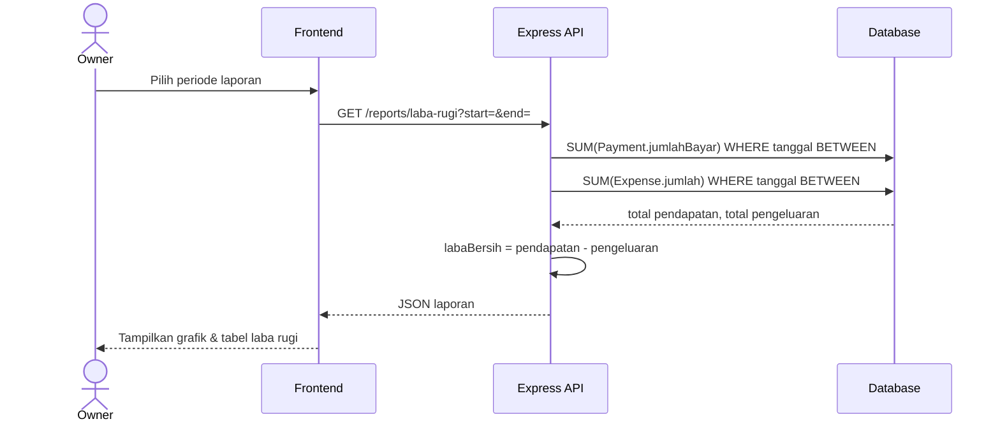
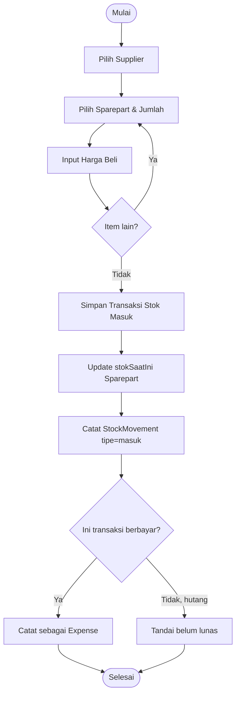

# Blueprint Sistem Manajemen Stok & Laporan Keuangan Bengkel Motor

**Stack:** Node.js (Express) + Database Relasional (PostgreSQL/MySQL)
**Pengguna:** Owner/Pemilik Bengkel (single role, single lokasi)
**Cakupan:** Manajemen Stok Sparepart, Transaksi Service, Laporan Keuangan (Pendapatan & Pengeluaran)

---

## 1. Ringkasan Kebutuhan

| Aspek | Keterangan |
|---|---|
| Skala | 1 bengkel, 1 lokasi |
| Pengguna | Owner (akses penuh) — role lain bisa ditambah belakangan (kasir/mekanik) |
| Modul | Master Data, Stok Sparepart, Transaksi Service, Kasir/Penjualan, Keuangan & Laporan |
| Output laporan | Laporan pendapatan, pengeluaran, laba rugi, stok, kartu stok |

---

## 2. Daftar Modul & Fitur Detail

### 2.1 Modul Master Data
- Data Sparepart (kode, nama, kategori, satuan, harga beli, harga jual, stok minimum)
- Data Kategori Sparepart (oli, ban, kampas rem, dll)
- Data Supplier/Pemasok
- Data Pelanggan (opsional, untuk histori service)
- Data Jenis Layanan Service (ganti oli, servis rutin, tune up, dll — beserta harga jasa standar)

### 2.2 Modul Manajemen Stok
- Stok masuk (pembelian dari supplier)
- Stok keluar (pemakaian untuk service / penjualan langsung)
- Kartu stok (mutasi per item)
- Notifikasi stok menipis (di bawah stok minimum)
- Stok opname (penyesuaian fisik vs sistem)

### 2.3 Modul Transaksi Service & Penjualan
- Buat order service (data pelanggan, motor, keluhan, mekanik)
- Tambah item sparepart yang dipakai (otomatis mengurangi stok)
- Tambah jasa layanan
- Hitung total (jasa + sparepart)
- Status transaksi (menunggu, dikerjakan, selesai, dibayar)
- Cetak nota/invoice

### 2.4 Modul Keuangan & Laporan
- Pencatatan pendapatan (otomatis dari transaksi service/penjualan)
- Pencatatan pengeluaran manual (belanja sparepart, operasional, gaji, listrik, dll)
- Kas masuk & keluar (buku kas harian)
- Laporan laba rugi (periode: harian/bulanan/tahunan)
- Laporan stok (nilai stok, item terlaris, stok menipis)
- Dashboard ringkasan (grafik pendapatan vs pengeluaran)

### 2.5 Modul Pengaturan
- Profil bengkel
- Manajemen user (jika nanti ditambah role lain)
- Backup data

---

## 3. Use Case Diagram



---

## 4. Class Diagram (Domain Model)



---

## 5. Entity Relationship Diagram (ERD)



---

## 6. Sequence Diagram — Alur Order Service (dari input sampai stok & keuangan terupdate)



---

## 7. Sequence Diagram — Alur Laporan Keuangan



---

## 8. Activity Diagram — Stok Masuk (Pembelian dari Supplier)



---

## 9. Rancangan Skema Database (ringkas)

```sql
CREATE TABLE users (
    id SERIAL PRIMARY KEY,
    nama VARCHAR(100) NOT NULL,
    email VARCHAR(100) UNIQUE NOT NULL,
    password_hash VARCHAR(255) NOT NULL,
    role VARCHAR(20) DEFAULT 'owner',
    created_at TIMESTAMP DEFAULT NOW()
);

CREATE TABLE categories (
    id SERIAL PRIMARY KEY,
    nama_kategori VARCHAR(50) NOT NULL
);

CREATE TABLE suppliers (
    id SERIAL PRIMARY KEY,
    nama VARCHAR(100) NOT NULL,
    kontak VARCHAR(50),
    alamat TEXT
);

CREATE TABLE spareparts (
    id SERIAL PRIMARY KEY,
    kode_item VARCHAR(30) UNIQUE NOT NULL,
    nama VARCHAR(100) NOT NULL,
    category_id INT REFERENCES categories(id),
    satuan VARCHAR(20),
    harga_beli DECIMAL(12,2),
    harga_jual DECIMAL(12,2),
    stok_saat_ini INT DEFAULT 0,
    stok_minimum INT DEFAULT 5
);

CREATE TABLE customers (
    id SERIAL PRIMARY KEY,
    nama VARCHAR(100),
    no_hp VARCHAR(20),
    plat_motor VARCHAR(20),
    model_motor VARCHAR(50)
);

CREATE TABLE service_types (
    id SERIAL PRIMARY KEY,
    nama_layanan VARCHAR(100) NOT NULL,
    harga_jasa DECIMAL(12,2)
);

CREATE TABLE service_orders (
    id SERIAL PRIMARY KEY,
    customer_id INT REFERENCES customers(id),
    user_id INT REFERENCES users(id),
    tanggal_masuk TIMESTAMP DEFAULT NOW(),
    status_order VARCHAR(20) DEFAULT 'menunggu',
    total_jasa DECIMAL(12,2) DEFAULT 0,
    total_sparepart DECIMAL(12,2) DEFAULT 0,
    total_keseluruhan DECIMAL(12,2) DEFAULT 0
);

CREATE TABLE service_order_items (
    id SERIAL PRIMARY KEY,
    service_order_id INT REFERENCES service_orders(id),
    tipe_item VARCHAR(20) NOT NULL, -- 'sparepart' / 'jasa'
    spare_part_id INT REFERENCES spareparts(id),
    service_type_id INT REFERENCES service_types(id),
    qty INT DEFAULT 1,
    harga_satuan DECIMAL(12,2),
    subtotal DECIMAL(12,2)
);

CREATE TABLE stock_movements (
    id SERIAL PRIMARY KEY,
    spare_part_id INT REFERENCES spareparts(id),
    supplier_id INT REFERENCES suppliers(id),
    service_order_id INT REFERENCES service_orders(id),
    tipe VARCHAR(10) NOT NULL, -- 'masuk' / 'keluar'
    jumlah INT NOT NULL,
    tanggal TIMESTAMP DEFAULT NOW(),
    keterangan TEXT
);

CREATE TABLE payments (
    id SERIAL PRIMARY KEY,
    service_order_id INT REFERENCES service_orders(id),
    tanggal_bayar TIMESTAMP DEFAULT NOW(),
    jumlah_bayar DECIMAL(12,2),
    metode_bayar VARCHAR(20)
);

CREATE TABLE expenses (
    id SERIAL PRIMARY KEY,
    kategori VARCHAR(50),
    keterangan TEXT,
    jumlah DECIMAL(12,2),
    tanggal TIMESTAMP DEFAULT NOW()
);
```

---

## 10. Rancangan REST API (Express)

```
Auth
  POST   /api/auth/login
  POST   /api/auth/logout

Master Data
  GET    /api/categories
  POST   /api/categories
  GET    /api/suppliers
  POST   /api/suppliers
  GET    /api/service-types
  POST   /api/service-types
  GET    /api/customers
  POST   /api/customers

Sparepart & Stok
  GET    /api/spareparts
  POST   /api/spareparts
  PUT    /api/spareparts/:id
  GET    /api/spareparts/:id/kartu-stok
  POST   /api/stock-movements/masuk
  POST   /api/stock-movements/keluar
  GET    /api/stock-movements?tipe=&start=&end=

Service Order
  GET    /api/service-orders
  POST   /api/service-orders
  GET    /api/service-orders/:id
  PUT    /api/service-orders/:id/status
  POST   /api/service-orders/:id/items
  POST   /api/service-orders/:id/payment
  GET    /api/service-orders/:id/invoice

Keuangan
  GET    /api/expenses
  POST   /api/expenses
  GET    /api/reports/laba-rugi?start=&end=
  GET    /api/reports/stok
  GET    /api/reports/dashboard
```

---

## 11. Struktur Folder Backend (disarankan)

```
bengkel-app/
├── src/
│   ├── config/          # koneksi database, env
│   ├── models/          # model Sequelize/Prisma
│   ├── controllers/     # logic tiap endpoint
│   ├── routes/          # definisi route express
│   ├── services/        # business logic (hitung stok, laporan)
│   ├── middlewares/     # auth, validasi, error handler
│   └── utils/
├── migrations/
├── seeders/
├── tests/
├── .env
├── package.json
└── server.js
```

---

## 12. Rekomendasi Teknologi Pendukung

| Layer | Rekomendasi |
|---|---|
| Backend | Node.js + Express.js |
| Database | PostgreSQL (disarankan) atau MySQL |
| ORM | Sequelize atau Prisma |
| Auth | JWT (jsonwebtoken) + bcrypt |
| Frontend | React.js / Vue.js (SPA), atau EJS jika ingin sederhana (server-rendered) |
| Cetak Nota/Laporan | PDFKit atau puppeteer untuk export PDF |
| Grafik Dashboard | Chart.js / Recharts |
| Validasi | Joi atau express-validator |

---

## 13. Roadmap Pengembangan (Bertahap)

1. **Fase 1 – Fondasi:** Setup project, database, autentikasi owner.
2. **Fase 2 – Master Data:** CRUD sparepart, kategori, supplier, jenis layanan, pelanggan.
3. **Fase 3 – Stok:** Stok masuk, stok keluar, kartu stok, notifikasi stok minimum.
4. **Fase 4 – Transaksi Service:** Order service, tambah item, cetak invoice.
5. **Fase 5 – Keuangan:** Pencatatan pengeluaran, laporan laba rugi, dashboard.
6. **Fase 6 – Penyempurnaan:** Multi-user/role (kasir, mekanik), backup otomatis, export Excel/PDF.

---

*Blueprint ini bisa disesuaikan lebih lanjut — misalnya menambah role kasir/mekanik, sistem multi-cabang, atau integrasi pembayaran digital, jika dibutuhkan di kemudian hari.*
